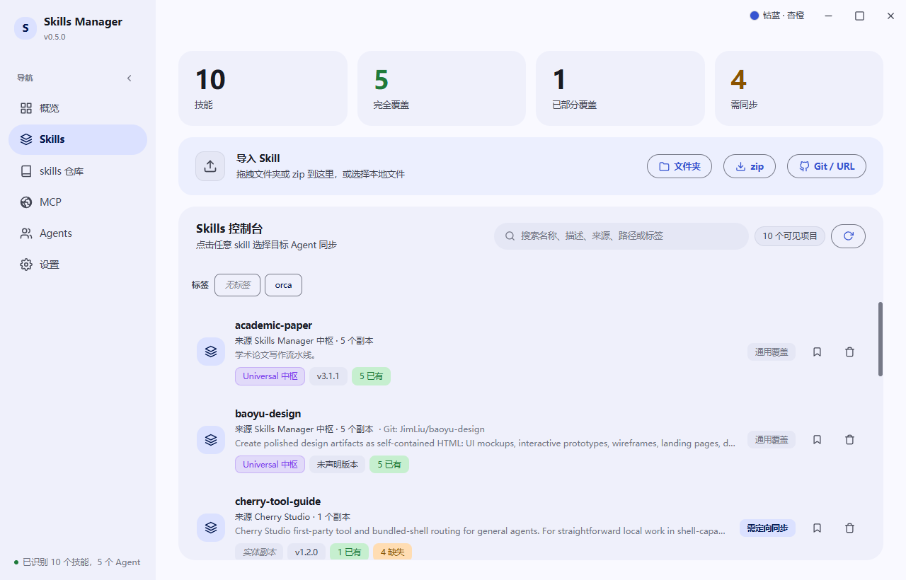
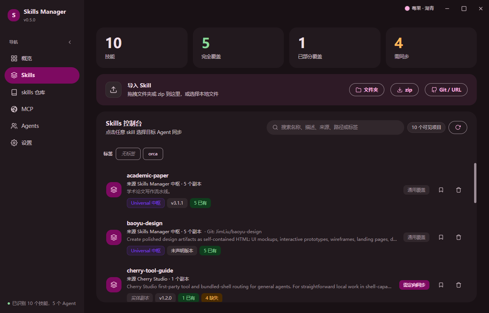
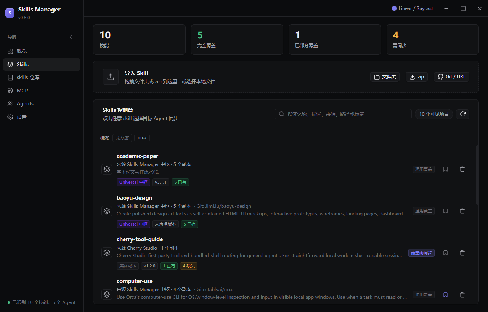
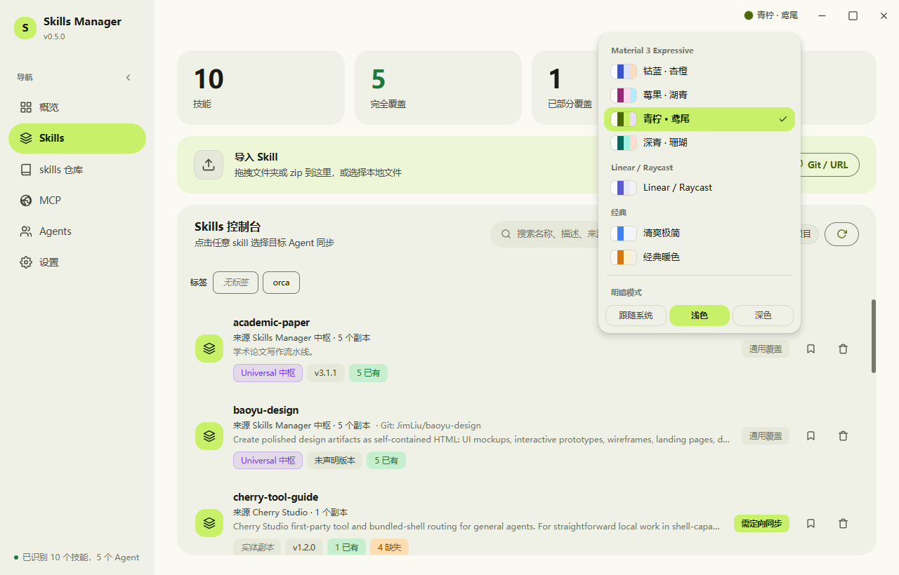
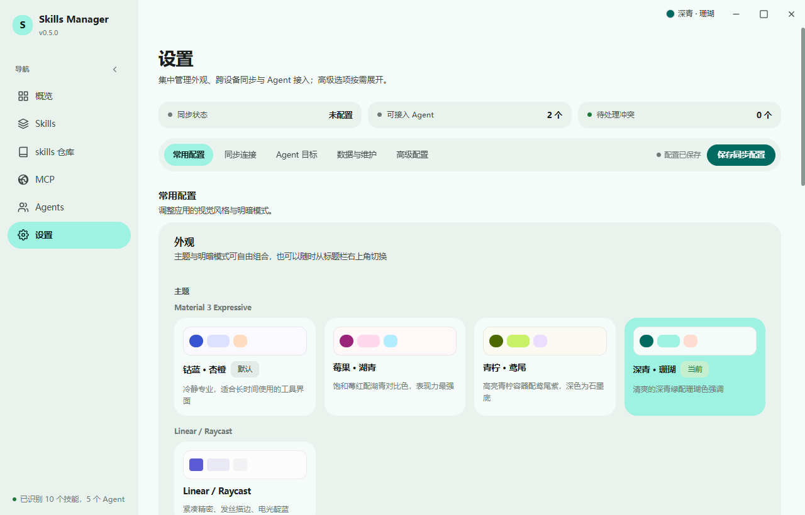

# Skills Manager Screenshots

[中文](SCREENSHOTS.md) · [Back to README](../README_EN.md)

Skills Manager ships 7 themes: Material 3 Expressive "Cobalt · Apricot" (default), "Berry · Lagoon", "Lime · Iris", "Teal · Coral", Linear / Raycast, and the classic "Clean Minimal" and "Classic Warm". Every theme supports light, dark, and system mode, and can be switched anytime from the title bar or Settings.

## Skills console · Material 3 · Cobalt · Apricot (default, light)

## Material 3 · Berry · Lagoon (dark)

## Linear / Raycast (dark)

## Title bar theme menu · Material 3 · Lime · Iris

## Theme picker in Settings · Material 3 · Teal · Coral

