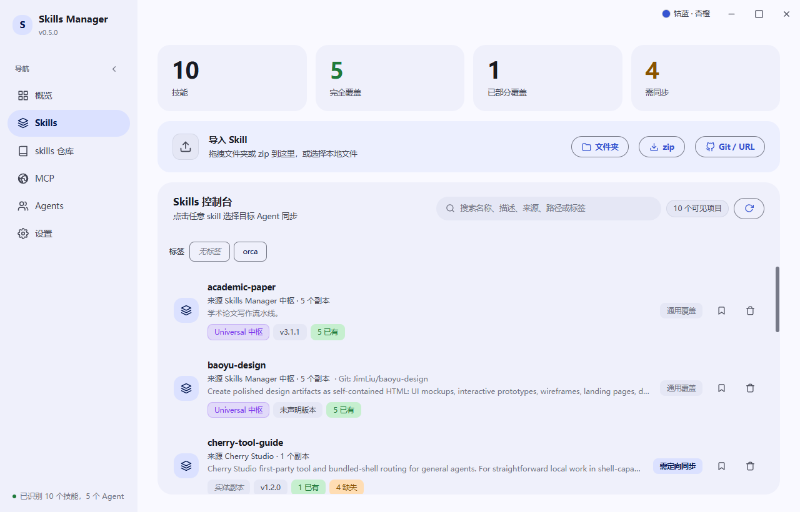
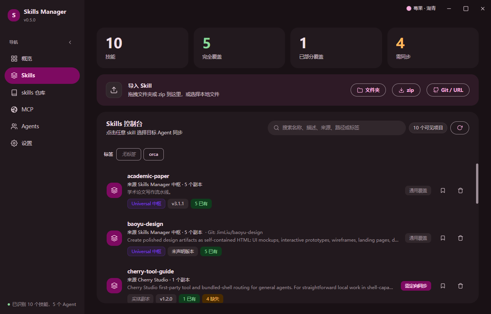
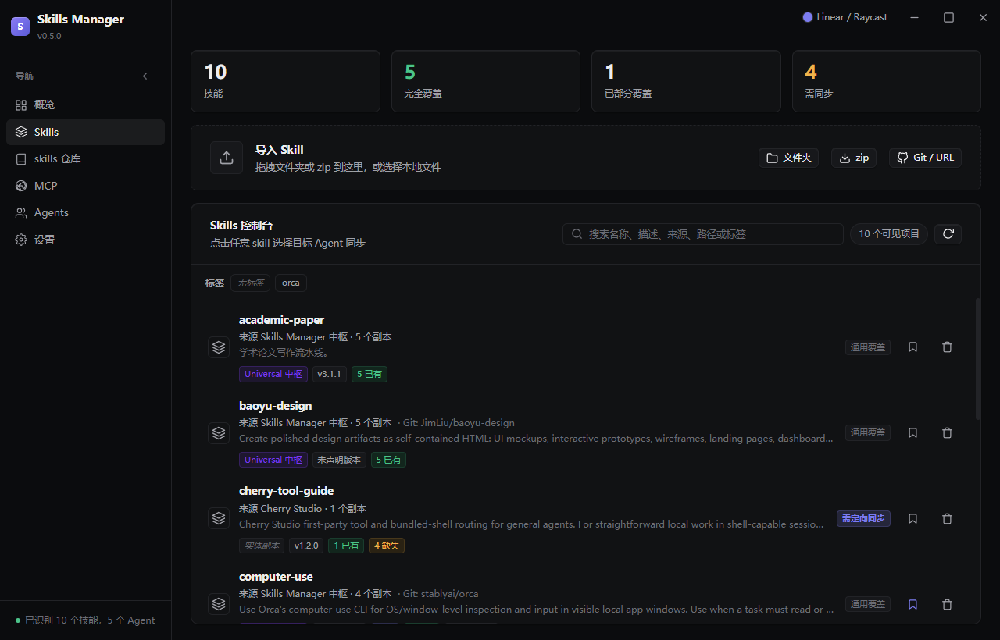
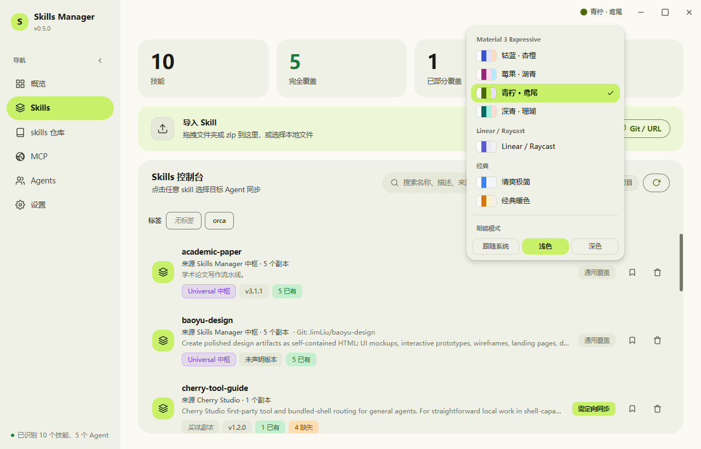
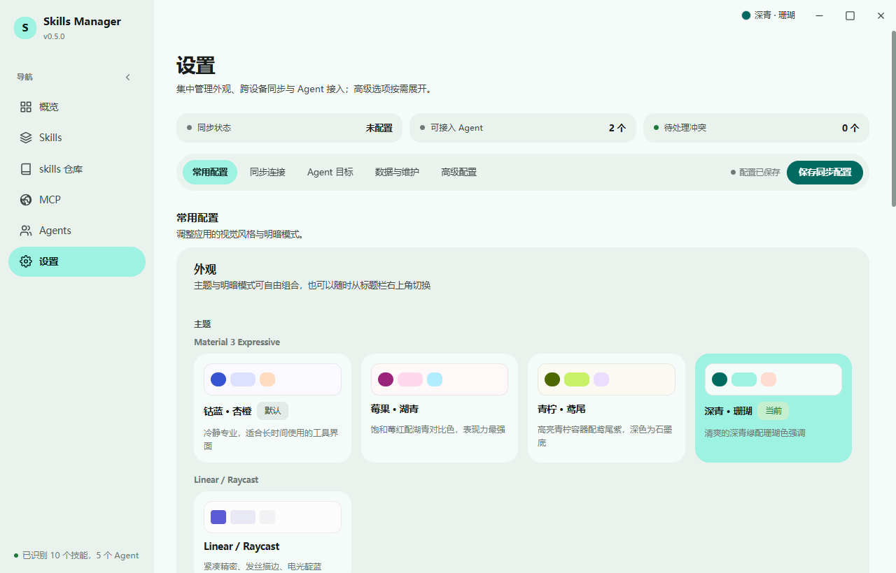

# Skills Manager 截图

[English](SCREENSHOTS.en.md) · [返回 README](../README.md)

Skills Manager 内置 7 个主题：Material 3 Expressive 的「钴蓝 · 杏橙」（默认）、「莓果 · 湖青」「青柠 · 鸢尾」「深青 · 珊瑚」，Linear / Raycast，以及经典的「清爽极简」「经典暖色」。每个主题都支持浅色、深色与跟随系统，可在标题栏右上角或设置页随时切换。

## Skills 控制台 · Material 3 · 钴蓝 · 杏橙（默认，浅色）

## Material 3 · 莓果 · 湖青（深色）

## Linear / Raycast（深色）

## 标题栏主题菜单 · Material 3 · 青柠 · 鸢尾

## 设置页主题选择 · Material 3 · 深青 · 珊瑚

